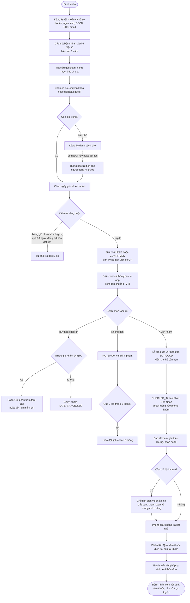
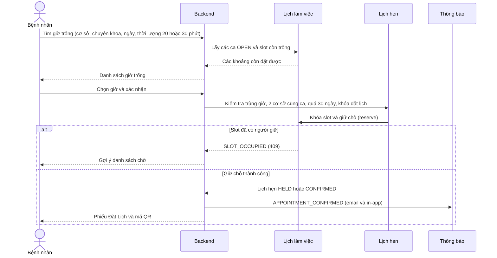
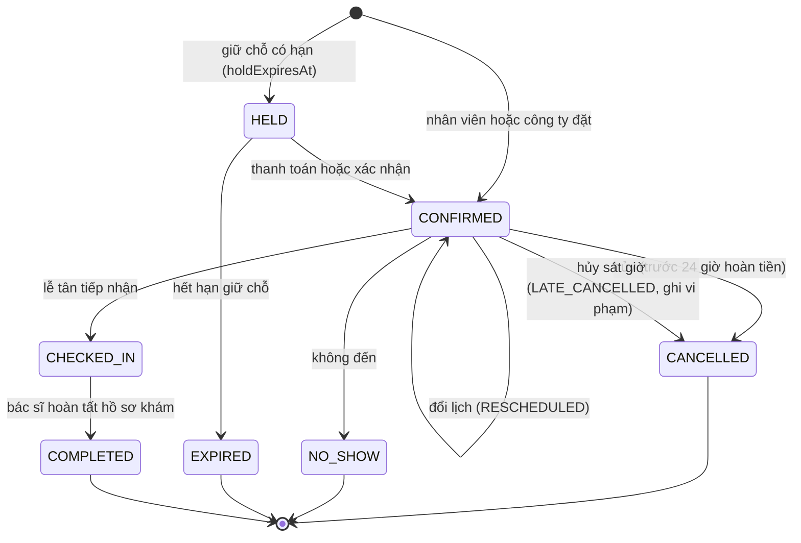
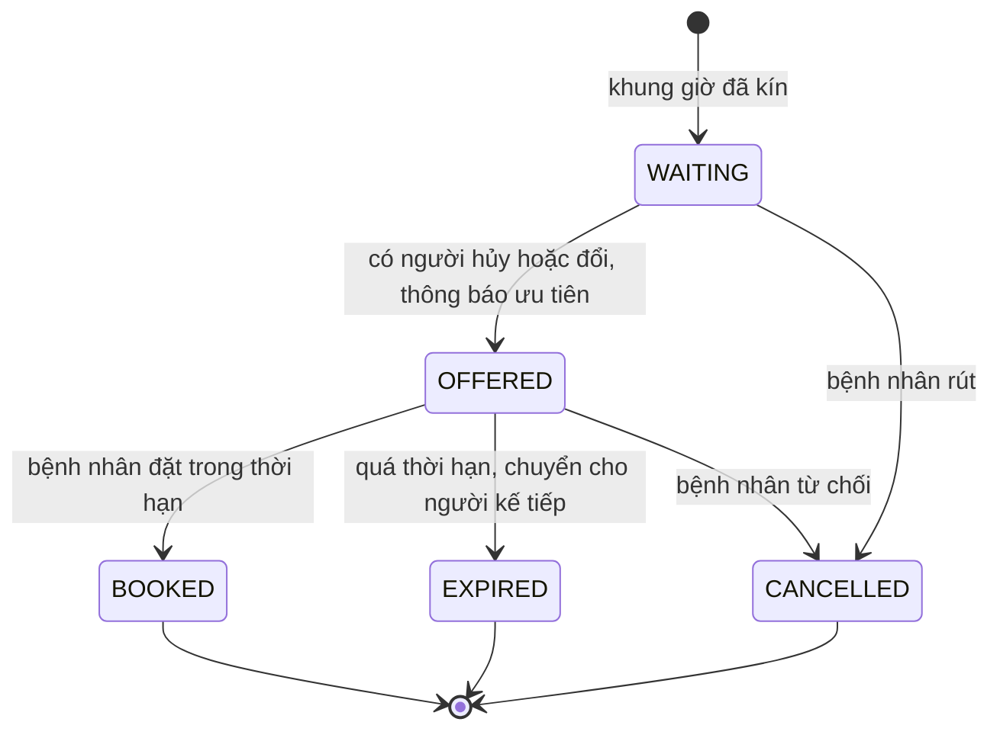
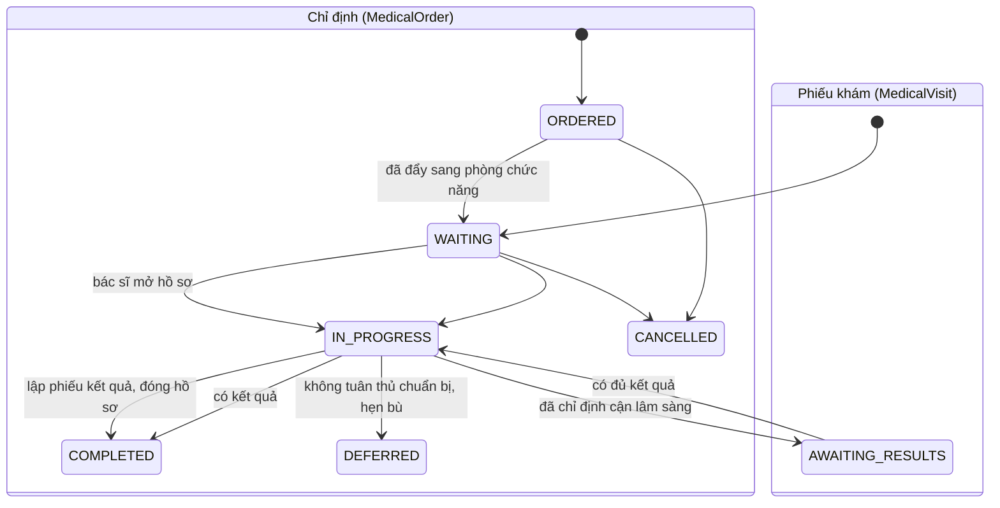
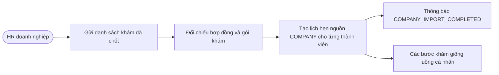

# Luồng bệnh nhân

Mô tả luồng bệnh nhân từ lúc đăng ký đến sau khi khám, theo `docs/de-tai.md` và các entity/enum
trong code (`appointment`, `examination`, `payment`, `violation`, `notification`, `company`).
Đây là thiết kế dự kiến, không phải mô tả hành vi đã chạy: xem mục "Trạng thái triển khai" ở cuối.

## 1. Tổng quan luồng

## 2. Đặt lịch (trình tự)

## 3. Trạng thái lịch hẹn

Theo `AppointmentStatus` và `AppointmentAction`. Các mũi tên là luồng dự kiến theo đề tài.

## 4. Danh sách chờ

Theo `WaitlistStatus`.

## 5. Phiếu khám và chỉ định

Theo `MedicalVisitStatus` và `MedicalOrderStatus`.

## 6. Bệnh nhân thuộc hợp đồng doanh nghiệp

Bệnh nhân loại `COMPANY` không tự đặt lịch. Doanh nghiệp gửi danh sách chốt từ HR, hệ thống tạo lịch
hẹn với nguồn `COMPANY` cho từng thành viên hợp đồng.

## 7. Trạng thái triển khai

| Bước | Có API | Ghi chú |
|---|---|---|
| Cấu hình cơ sở, phòng, chuyên khoa, bác sĩ, gói khám, lịch làm việc | Có | Phía Admin, đã test |
| Tìm giờ trống (`GET /api/v1/doctor-schedules/availability`) | Có | Cần đăng nhập |
| Hàng đợi bác sĩ (`GET /api/v1/doctor-schedules/my/{id}/patients`) | Có | Dữ liệu rỗng vì chưa có lịch hẹn |
| Đăng ký tài khoản và hồ sơ bệnh nhân | Chưa | Entity và migration đã có |
| Đặt, hủy, đổi lịch hẹn; danh sách chờ | Chưa | Có `AppointmentReservationService` (nội bộ) |
| Tiếp nhận, khám, chỉ định, kết quả | Chưa | Entity `examination` đã có |
| Thanh toán, hoàn tiền, hóa đơn | Chưa | Entity `payment` đã có |
| Vi phạm, khóa đặt lịch, thông báo | Chưa | Entity đã có |

Câu hỏi còn mở từ đề tài (mục 6): ràng buộc sức chứa cho ca ngoài giờ 3 giờ chưa được chốt.
